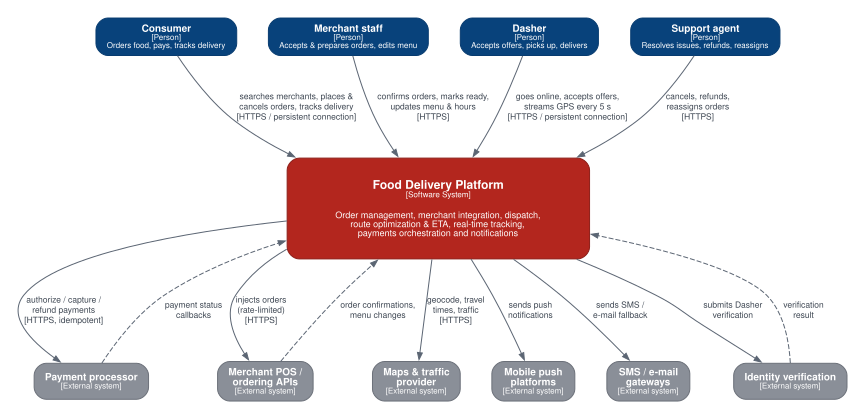
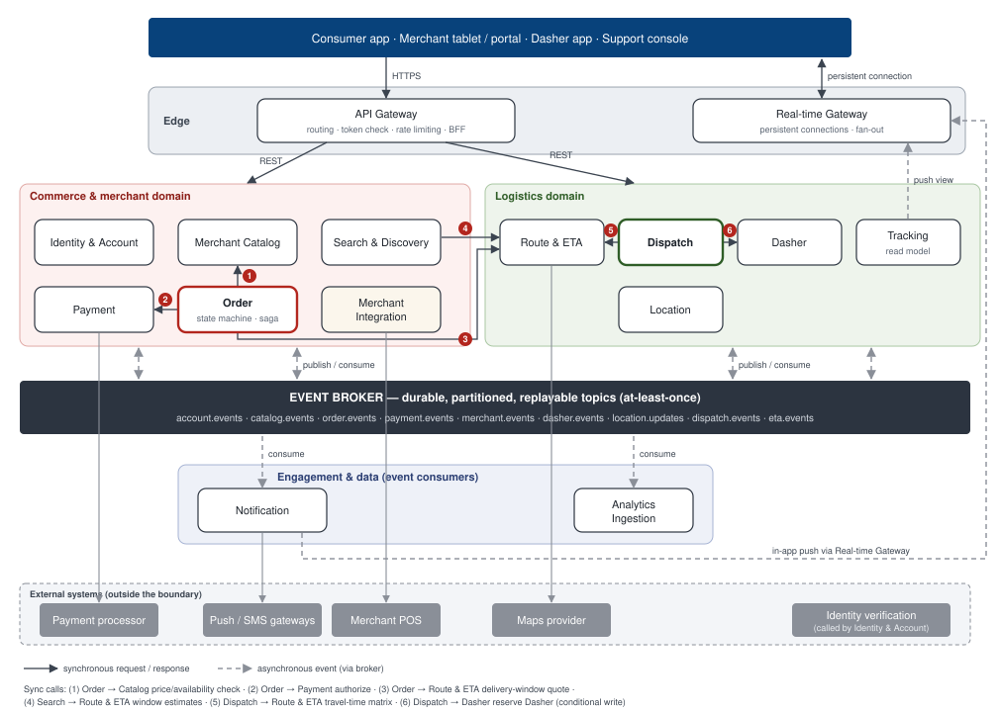
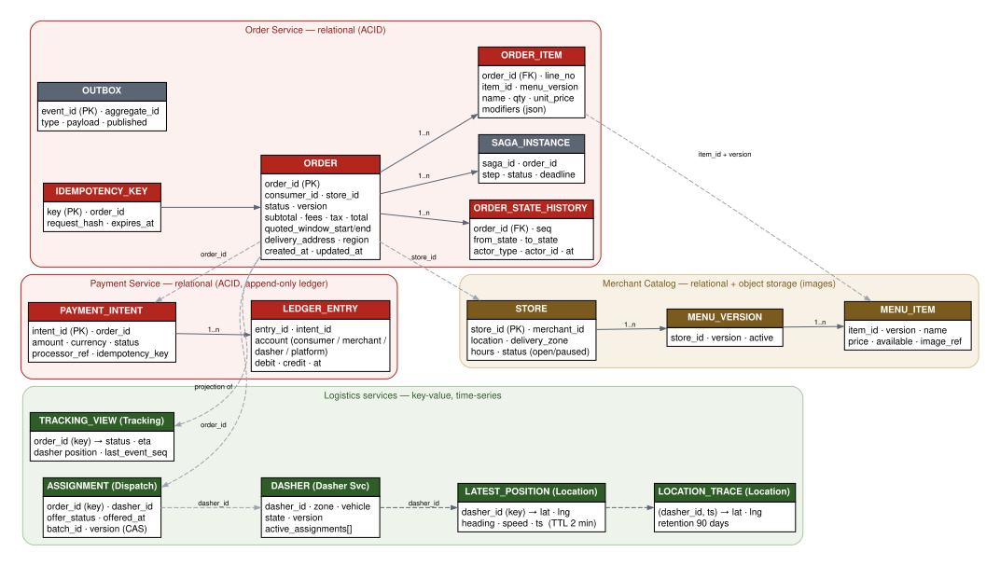
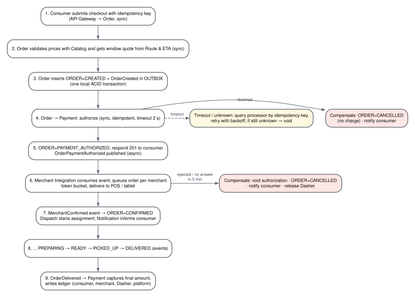
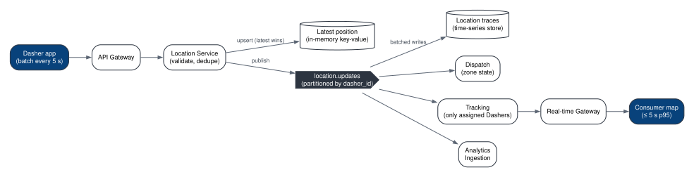

<section class="cover">

Universidad Distrital Francisco José de Caldas School of Engineering · Computer Engineering Program

Cloud Computing · Semester 2026-III

DoorDash — Food Delivery Platform

Delivery No. 2 — Software Architecture

Focus domain: Order Management, Route Optimization &amp; Notifications

<table>
<tr><td><b>Team</b></td><td>Team 2</td></tr>
<tr><td><b>Members</b></td><td>Daniel Felipe Barrera Suárez Jaider Camilo Carvajal Marín Nelson David Posso Suárez Edward Julián García Gaitán Julián David Cabrera Barragán</td></tr>
<tr><td><b>Professor</b></td><td>Eng. Carlos Andrés Sierra, M.Sc.</td></tr>
<tr><td><b>Date</b></td><td>September 2026</td></tr>
</table>

</section>

<!-- TOC -->

## 1. Executive Summary

Delivery 1 established *what* the platform must do: twelve functional requirements (FR-01 – FR-12), nineteen measurable non-functional requirements (NFR-01 – NFR-19) and a workload model sized at **50,000 concurrent orders at peak**, **75,000 new orders per hour**, **51.6 million requests per hour** (of which **36 million are Dasher location reports**), **99.9 % availability**, eventual consistency for order status and time-based delivery-window SLAs. This document answers *how the software is structured* to satisfy them. It is deliberately **cloud-independent**: every component is described with generic terms (relational database, key-value store, message broker, object storage, API gateway); the mapping to a cloud provider is the subject of Delivery 3.

The architecture decomposes the platform into **15 independently deployable services** in four groups — *edge*, *commerce & merchant*, *logistics*, and *engagement & data* — connected by synchronous request/response calls where an actor is waiting for an answer and by a **durable, partitioned event broker** everywhere else. The design follows eight principles:

1. **Bounded contexts, one owner per datum.** Each service owns its data store exclusively; other services read it through APIs or events, never through shared tables (ADR-01, ADR-04).
2. **The order is a state machine with a single writer.** Only the Order Service changes an order's state; merchants, Dashers and payments emit *facts* as events and the Order Service decides the transition (FR-05).
3. **Event-driven by default, synchronous by exception.** Only six internal synchronous calls exist, all on paths where a human is waiting; synchronous call depth never exceeds two hops (ADR-02).
4. **Sagas instead of distributed transactions.** Order placement and cancellation span Order, Payment and Merchant Integration; they are coordinated by an orchestrated saga with explicit compensations (ADR-03), and every event is published through a transactional outbox (ADR-05).
5. **Separate the hot telemetry path from the transactional path.** Location reports are write-dominated (≈ 73 % of all requests) and tolerate loss of individual points; they flow through a dedicated Location Service and in-memory store, isolated from the ACID stores that hold orders and money (ADR-07).
6. **CQRS for read-heavy views.** Discovery/search and order tracking are served from denormalized read models fed by events, so 90 % of transactional traffic (reads) never touches the order or catalog write stores (ADR-06).
7. **Protect external dependencies.** Merchant POS APIs are called only through per-merchant queues with token-bucket rate limiting (ADR-09); payment authorization is synchronous but capture and refund are asynchronous and idempotent (ADR-08).
8. **Design for horizontal scaling and failure isolation.** All request-serving services are stateless; state lives in data stores partitioned by region, zone, order or Dasher identifier, preparing for the multi-region deployment and the 20× growth scenario of Delivery 3.

## 2. System Context (C4 Level 1)

Following the C4 model [8], the platform is drawn as a single black box. The context diagram is consistent with the actor catalog (A-01 – A-09) and use cases (UC-01 – UC-10) of Delivery 1. Interaction frequencies below are taken from the Delivery 1 workload model at peak.

| External element | What it is | How it interacts with the platform | Frequency (peak) |
|---|---|---|---|
| Consumer (A-01) | Person ordering through mobile or web app | Browses and searches merchants, manages cart, places and cancels orders, tracks delivery over a persistent connection, receives notifications | ≈ 13.5 M requests/h (browsing 7.5 M + tracking 6.0 M); 90,000 concurrent |
| Merchant staff (A-02) | Restaurant employee using tablet or web portal | Receives orders, confirms or rejects with preparation time, marks orders ready, edits menu, hours and availability, pauses store | ≈ 0.75 M interactions/h; 45,000 active devices |
| Dasher (A-03) | Independent courier using the Dasher app | Goes online/offline, streams GPS every 5 s, accepts or declines offers, reports arrival, pickup and drop-off | 36 M location reports/h + ≈ 1.1 M actions/h; 50,000 online |
| Support agent (A-04) | Operations employee using the support console | Views order timelines, cancels, refunds, reassigns Dashers | ≈ 2–5 % of orders (≈ 2,000–4,000/h) |
| Payment processor (A-05) | External card-processing service | Receives authorize / capture / void / refund requests (idempotent); sends asynchronous status callbacks | ≈ 0.3 M calls/h (≈ 83/s) |
| Merchant POS / ordering API (A-06) | Merchant's own point-of-sale system | Receives injected orders; sends confirmations and menu changes; imposes per-integration rate limits (≈ 300 req/60 s) | ≈ 0.2 M calls/h, bounded per merchant |
| Maps & traffic provider (A-07) | External geocoding, routing and traffic service | Answers geocoding and travel-time queries; results are cached by zone and time bucket | ≈ 1–3 M queries/h before caching |
| Mobile push platforms (A-08) | Operating-system push delivery services | Receive push messages addressed to device tokens | ≈ 0.6 M messages/h |
| SMS / e-mail gateways (A-08) | External messaging providers | Receive fallback SMS and receipts by e-mail | ≈ 5 % of messages |
| Identity verification (A-09) | External background-check service | Receives Dasher onboarding checks; returns results asynchronously | ≈ 100–500/day |

## 3. Software Architecture — Service Decomposition

### 3.1 Architecture Overview

| Group | Services | Why grouped |
|---|---|---|
| Edge | S-01 API Gateway, S-02 Real-time Gateway | Cross-cutting entry points: authentication, rate limiting, protocol termination. No business logic. |
| Commerce & merchant | S-03 Identity & Account, S-04 Merchant Catalog, S-05 Search & Discovery, S-06 Order, S-07 Payment, S-08 Merchant Integration | Everything needed to go from "browse" to "paid order accepted by the merchant". |
| Logistics | S-09 Dasher, S-10 Location, S-11 Dispatch, S-12 Route & ETA, S-13 Tracking | Everything about moving food: supply state, positions, assignment, routing, the live delivery view. |
| Engagement & data | S-14 Notification, S-15 Analytics Ingestion | Pure event consumers; they can fail or lag without stopping orders (NFR-11). |

### 3.2 Service Boundary Rationale

Every boundary is a design decision; the most significant ones are recorded as ADRs in Section 6.

- **Order vs. Payment.** Money has stricter consistency, audit and compliance requirements (FR-07, NFR-12) and a different external dependency (the processor). Keeping the ledger in its own service isolates those concerns and lets it evolve independently.
- **Cart and pricing stay inside Order.** A cart becomes an order in the same aggregate; splitting it would force a saga for every checkout without any scaling benefit (cart traffic is < 1 % of requests).
- **Merchant Integration separate from Order and Catalog.** It is the only place that speaks to merchant POS systems, so rate limits, retries and channel-specific adapters (API, tablet, fallback) are contained in one service (ADR-09). A misbehaving POS cannot back-pressure order creation.
- **Search & Discovery separate from Catalog.** Catalog is the write-side source of truth (≈ tens of writes/s); Search is a read model with geo and full-text indexes serving ≈ 1,000 req/s at peak (ADR-06).
- **Location separate from Dasher.** Location handles 10,000 writes/s of loss-tolerant telemetry; Dasher handles ≈ 300 req/s of state transitions that must be exact. Different storage, scaling and consistency (ADR-07).
- **Dispatch separate from Route & ETA.** Dispatch is a stateful, per-zone optimization loop; Route & ETA is a stateless computation also used by Search (delivery-window estimates) and Order (checkout quote). Splitting avoids coupling checkout latency to dispatch cycles.
- **Tracking separate from Order.** Tracking serves 1,667 reads/s at peak and merges data from four sources (order status, assignment, ETA, position); making it a projection keeps the Order write store free of read load (ADR-06).
- **Notification as a consumer only.** Notifications never block a state transition; if the Notification Service is down, events accumulate in the broker and are delivered on recovery (FR-12, NFR-11).

### 3.3 Service Catalog

Instance counts are *logical* instances of a reference unit, computed as ⌈load ÷ per-instance capacity ÷ 0.7⌉ (70 % target utilization), with a minimum of three instances for core services (one per failure domain) and two for non-critical ones. Per-instance capacities are planning assumptions to be validated by load tests in Delivery 4.

| Service | Stateless? | Scaling driver | Peak load | Capacity / instance | Instances avg / peak |
|---|---|---|---|---|---|
| S-01 API Gateway | Stateless | Request rate | 14,300 req/s | 2,000 req/s | 5 / 11 |
| S-02 Real-time Gateway | Stateful (connections) | Open connections | 145,000 connections | 10,000 connections | 10 / 21 |
| S-03 Identity & Account | Stateless | Request rate | 125 req/s | 300 req/s | 3 / 3 |
| S-04 Merchant Catalog | Stateless | Request rate (menu reads) | 1,100 req/s | 500 req/s | 3 / 4 |
| S-05 Search & Discovery | Stateless (index in store) | Query rate, CPU | 1,040 req/s | 200 req/s | 3 / 8 |
| S-06 Order | Stateless | Request + event rate | 520 ops/s | 150 ops/s | 3 / 5 |
| S-07 Payment | Stateless | Request rate, processor latency | 83 req/s | 60 req/s | 3 / 3 |
| S-08 Merchant Integration | Stateless workers | Queue depth | 208 msg/s | 100 msg/s | 3 / 3 |
| S-09 Dasher | Stateless | Request rate | 315 req/s | 300 req/s | 3 / 3 |
| S-10 Location | Stateless | Write rate | 10,000 writes/s | 2,500 writes/s | 3 / 6 |
| S-11 Dispatch | Stateful (zone partitions) | Orders in flight per zone, CPU | 50,000 orders | 5,000 orders | 5 / 15 |
| S-12 Route & ETA | Stateless | Computation rate, CPU | 3,000 req/s | 300 req/s | 5 / 15 |
| S-13 Tracking | Stateless (view in store) | Reads + event rate | 1,670 req/s | 500 req/s | 3 / 5 |
| S-14 Notification | Stateless workers | Queue depth | 170 msg/s | 100 msg/s | 2 / 3 |
| S-15 Analytics Ingestion | Stateless workers | Event rate (consumer lag) | 14,300 events/s | 3,000 events/s | 2 / 7 |

The subsections below define each service. **Public** endpoints are exposed through the API Gateway (REST over HTTPS, JSON); **internal** operations are RPC over HTTP/2 with schema-defined contracts; **events** are published to the named broker topic.

#### S-01 — API Gateway

- **Responsibility.** Single public entry point: TLS termination, routing to services, verification of signed access tokens (using keys published by S-03, no call per request), per-client and per-IP rate limiting, request size limits, and screen-level aggregation for mobile clients (backend-for-frontend). **Does not** contain business rules or store business data.
- **APIs.** Exposes the public `/v1/*` surface of all services listed below; `GET /health`.
- **Data owned.** Routing and rate-limit configuration only.
- **Dependencies.** S-03 (token-signing keys, cached); all domain services (routing).
- **Scaling.** Stateless; scales on request rate; 5 instances average, 11 at peak.

#### S-02 — Real-time Gateway

- **Responsibility.** Holds persistent bidirectional connections with consumer, Dasher and merchant apps; authenticates the connection; lets clients subscribe to channels they are authorized for (`order:{id}`, `dasher:{id}`, `store:{id}`); delivers messages pushed by S-13, S-14 and S-08. **Does not** decide what to send.
- **APIs.**

| Type | Operation | Description |
|---|---|---|
| Public | `GET /v1/realtime` (connection upgrade) | Open persistent connection; subscribe/unsubscribe messages |
| Internal | `Deliver(channel, message, ttl)` | Push a message to all connections subscribed to a channel |
| Internal | `Presence(channel)` | Whether a recipient is currently connected (used by S-14 to choose push vs in-app) |

- **Data owned.** Ephemeral connection registry (channel → connection) in an in-memory key-value store.
- **Dependencies.** S-03 (token validation).
- **Scaling.** Stateful per connection; scales on open connections (10 average, 21 at peak); clients reconnect to any instance, so losing an instance drops only its connections.

#### S-03 — Identity & Account

- **Responsibility.** Registration and authentication for all actor types, role-based authorization claims, profiles, device/address book, Dasher onboarding workflow with the external verification provider (FR-01). **Does not** hold payment methods (S-07) or Dasher operational state (S-09).
- **APIs.**

| Method | Path | Description |
|---|---|---|
| POST | `/v1/accounts` | Register consumer, merchant staff or Dasher |
| POST | `/v1/auth/token` · `/v1/auth/refresh` | Issue / refresh short-lived signed access tokens |
| GET / PATCH | `/v1/accounts/me` | Read / update profile, addresses, language |
| POST | `/v1/dashers/{id}/verification` | Start Dasher background check |
| POST | `/v1/webhooks/identity-verification` | Result callback from verification provider |
| Event | `account.events` | `AccountCreated`, `DasherVerified`, `AccountSuspended` |

- **Data owned.** Accounts, hashed credentials, roles, profiles, addresses, verification status.
- **Dependencies.** Identity verification provider (asynchronous).
- **Scaling.** Stateless; 3 instances (minimum for availability) at average and peak.

#### S-04 — Merchant Catalog

- **Responsibility.** Source of truth for merchants, stores, delivery zones, opening hours, menus (versioned), items, modifiers, prices and availability (FR-03). Validates carts against the active menu version. **Does not** rank or search (S-05).
- **APIs.**

| Method | Path / operation | Description |
|---|---|---|
| GET | `/v1/stores/{storeId}` · `/v1/stores/{storeId}/menu` | Store detail and active menu (cacheable) |
| PUT | `/v1/merchant/stores/{storeId}/menu` | Publish a new menu version |
| PATCH | `/v1/merchant/stores/{storeId}/items/{itemId}` | Change price or availability |
| PATCH | `/v1/merchant/stores/{storeId}/status` | Open, close or pause store |
| Internal | `ValidateCart(storeId, items, menuVersion)` | Returns current prices, availability, store status |
| Event | `catalog.events` | `MenuPublished`, `ItemAvailabilityChanged`, `StoreStatusChanged` |

- **Data owned.** Merchant, store, zone, hours, menu version, menu item, modifier; item images in object storage.
- **Dependencies.** None synchronous (called by S-06 and S-08).
- **Scaling.** Stateless; read-heavy with a cache in front of the store; 3 / 4 instances.

#### S-05 — Search & Discovery

- **Responsibility.** Answers "what can I order here?": geo-filtered, ranked lists of open stores with delivery-window and fee estimates, and keyword search over stores and items (FR-02). Maintains its own denormalized index built from `catalog.events` and zone-level estimates from `eta.events`. **Does not** own any source-of-truth data.
- **APIs.**

| Method | Path | Description |
|---|---|---|
| GET | `/v1/discovery/feed?lat&lng` | Ranked open stores for an address, with window and fee |
| GET | `/v1/search?q&lat&lng&cuisine` | Keyword / cuisine search |
| Internal | `RebuildIndex(region)` | Operational full re-index from Catalog snapshot |

- **Data owned.** Search index (store documents with geo-shape of delivery zone, cuisines, item names, rating, status).
- **Dependencies.** S-12 (`ZoneEstimates`, batched and cached); consumes `catalog.events`, `eta.events`.
- **Scaling.** Stateless query nodes over a replicated index; CPU-bound; 3 / 8 instances.

#### S-06 — Order

- **Responsibility.** Carts, checkout, fee and tax computation, **the order state machine** of FR-05 (single writer of order state), cancellation policy, and orchestration of the place-order and cancel-order sagas (ADR-03). **Does not** talk to merchants, Dashers or the payment processor directly.
- **APIs.**

| Method | Path / operation | Description |
|---|---|---|
| POST | `/v1/carts` · PUT `/v1/carts/{id}/items` | Create cart, add / remove items |
| POST | `/v1/orders` (header `Idempotency-Key`) | Checkout: validate, quote window, authorize, create order |
| GET | `/v1/orders/{orderId}` · `/v1/orders?consumer=me` | Order detail and history (includes state history) |
| POST | `/v1/orders/{orderId}/cancel` | Consumer cancellation (policy-checked) |
| POST | `/v1/support/orders/{orderId}/cancel` · `/refund` | Support actions with reason codes |
| Event | `order.events` | `OrderCreated`, `OrderPaymentAuthorized`, `OrderConfirmed`, `OrderPreparing`, `OrderReady`, `OrderPickedUp`, `OrderDelivered`, `OrderCancelled`, `OrderDeliveryFailed`, `OrderDasherAssigned` |

- **Data owned.** Order, order item, order state history, cart, idempotency keys, saga instances, outbox.
- **Dependencies.** S-04 `ValidateCart`, S-12 `QuoteWindow`, S-07 `Authorize` (sync, checkout only); consumes `payment.events`, `merchant.events`, `dasher.events`, `dispatch.events`.
- **Scaling.** Stateless; data partitioned by order identifier within region; 3 / 5 instances.

#### S-07 — Payment

- **Responsibility.** Payment methods (tokens only), authorization, capture, void, refund, Dasher earnings entries and the double-entry ledger; reconciliation with processor reports (FR-07). **Does not** decide *when* to refund (policy is in S-06) — it executes monetary commands exactly once.
- **APIs.**

| Method | Path / operation | Description |
|---|---|---|
| POST / GET | `/v1/payment-methods` | Register tokenized card (token from processor's client SDK), list methods |
| Internal | `Authorize(orderId, amount, currency, methodId, idempotencyKey)` | Synchronous authorization at checkout |
| POST | `/v1/webhooks/payment-processor` | Asynchronous status callbacks |
| Event | `payment.events` | `PaymentAuthorized`, `PaymentAuthorizationFailed`, `PaymentCaptured`, `PaymentVoided`, `PaymentRefunded`, `DasherEarningRecorded` |

- **Data owned.** Payment intent, ledger entry (append-only), processor references, idempotency keys, reconciliation reports.
- **Dependencies.** Payment processor; consumes `order.events` (`OrderDelivered` → capture + earnings; `OrderCancelled` → void/refund).
- **Scaling.** Stateless; bound by processor latency (many requests in flight); 3 instances.

#### S-08 — Merchant Integration

- **Responsibility.** Delivers each paid order to the merchant through its channel (POS API, tablet via S-02, or fallback call queue for operations), enforces each integration's rate limit with a token bucket, retries with exponential backoff, de-duplicates by order identifier, receives confirmations/rejections/ready signals from all channels and normalizes them into events, escalates non-responsive merchants after 5 minutes (FR-06). Forwards POS-originated menu changes to S-04.
- **APIs.**

| Method | Path / operation | Description |
|---|---|---|
| GET | `/v1/merchant/orders?status=` | Tablet / portal order queue |
| POST | `/v1/merchant/orders/{orderId}/confirm` (`prepMinutes`) · `/reject` · `/ready` | Merchant actions |
| POST | `/v1/webhooks/pos/{integrationId}` | POS callbacks (confirmations, menu changes) |
| PUT | `/v1/merchant/integrations/{storeId}` | Channel and rate-limit configuration |
| Event | `merchant.events` | `OrderTransmitted`, `MerchantConfirmed`, `MerchantRejected`, `MerchantMarkedReady`, `MerchantUnresponsive` |

- **Data owned.** Integration configuration, transmission records (unique per order), outbound per-merchant work queue, rate-limit token buckets.
- **Dependencies.** Merchant POS systems; S-02 (tablet delivery); S-04 (`UpsertMenu` for POS-sourced menus); consumes `order.events`.
- **Scaling.** Stateless workers; scales on queue depth; 3 instances; per-merchant ordering keeps one merchant's backlog from affecting others.

#### S-09 — Dasher

- **Responsibility.** Dasher operational state machine (FR-08), online sessions and zones, offers received, delivery milestones (arrived, picked up, dropped off with proof), and heartbeat supervision (OFFLINE after 2 minutes without location). Provides the atomic reservation used by Dispatch so a Dasher cannot be assigned twice. **Does not** compute assignments (S-11) or store positions (S-10).
- **APIs.**

| Method | Path / operation | Description |
|---|---|---|
| POST / DELETE | `/v1/dasher/sessions` | Go online in a zone / go offline |
| GET | `/v1/dasher/offers` | Pending offers |
| POST | `/v1/dasher/offers/{offerId}/accept` · `/decline` | Respond to an offer (45 s timeout) |
| POST | `/v1/dasher/deliveries/{orderId}/arrived` · `/pickup` · `/dropoff` | Delivery milestones (drop-off with photo / PIN reference) |
| Internal | `ReserveDasher(dasherId, offerId, expectedVersion)` | Conditional write: succeeds only if the Dasher is still IDLE at that version |
| Event | `dasher.events` | `DasherOnline`, `DasherOffline`, `OfferAccepted`, `OfferDeclined`, `OfferExpired`, `ArrivedAtStore`, `DeliveryPickedUp`, `DeliveryDroppedOff` |

- **Data owned.** Dasher operational record (state, version, zone, vehicle, active assignments), sessions, offers, delivery proofs (references to object storage).
- **Dependencies.** Consumes `dispatch.events` (offers) and `location.updates` (last-seen timestamp only).
- **Scaling.** Stateless; 3 instances; data partitioned by Dasher identifier.

#### S-10 — Location

- **Responsibility.** Ingests batched GPS reports from Dasher apps, validates (plausible speed, accuracy), drops duplicates and stale points, keeps the latest position of each Dasher and publishes updates; answers proximity queries for dispatch; persists traces for 90 days (FR-11).
- **APIs.**

| Method | Path / operation | Description |
|---|---|---|
| POST | `/v1/dasher/locations` | Batch of points (every 5 s) |
| Internal | `GetLatest(dasherIds[])` | Latest known positions |
| Internal | `NearbyDashers(geoCell, radius, states)` | Candidate Dashers for dispatch |
| Event | `location.updates` | `DasherLocationUpdated` (partitioned by Dasher identifier) |

- **Data owned.** Latest position per Dasher (in-memory key-value with 2-minute expiry, indexed by geo cell) and location traces (time-series store).
- **Dependencies.** None synchronous.
- **Scaling.** Stateless; scales on write rate, 3 / 6 instances; see the data path in Figure 5.

#### S-11 — Dispatch

- **Responsibility.** Assigns confirmed orders to Dashers (FR-09): per delivery zone, runs an optimization cycle every 15–30 s over unassigned orders and candidate Dashers, scores options with predicted pickup and drop-off times from S-12 (including batching of up to two orders), following the ML-plus-optimization approach DoorDash describes for its dispatch engine [4], sends offers, re-dispatches on decline or 45-s timeout, and releases assignments on cancellation. **Does not** own Dasher state — it reserves Dashers through S-09.
- **APIs.**

| Method | Path / operation | Description |
|---|---|---|
| POST | `/v1/support/orders/{orderId}/reassign` | Manual reassignment by support |
| GET | `/internal/zones/{zoneId}/state` | Operational view of a zone (queue, supply, lateness) |
| Event | `dispatch.events` | `OfferCreated`, `DasherAssigned`, `AssignmentReleased`, `NoDasherAvailable` |

- **Data owned.** Assignment records (order → Dasher, offer status, batch, version) in a key-value store with conditional writes; in-memory zone state rebuilt from events on restart.
- **Dependencies.** S-12 `TravelTimeMatrix`; S-10 `NearbyDashers`; S-09 `ReserveDasher`; consumes `order.events`, `merchant.events` (ready time), `dasher.events`, `location.updates`.
- **Scaling.** Stateful by zone: each instance owns a set of zones (partition assignment is rebalanced on failure); CPU-bound; 5 / 15 instances.

#### S-12 — Route & ETA

- **Responsibility.** Delivery-window quotes at checkout, zone-level estimates for discovery, travel-time matrices for dispatch, stop sequencing for batched routes, and continuous ETA recomputation on order and Dasher milestones (FR-10); records predicted vs actual times to measure NFR-14. **Does not** decide assignments.
- **APIs.**

| Type | Operation | Description |
|---|---|---|
| Internal | `QuoteWindow(storeId, address, time)` | Window shown at checkout |
| Internal | `ZoneEstimates(zoneIds[])` | Cached estimates used by Search |
| Internal | `TravelTimeMatrix(origins[], destinations[])` | Travel times for dispatch scoring |
| Internal | `SequenceRoute(dasherId, stops[])` | Optimal pickup/drop-off order for a batch |
| Event | `eta.events` | `EtaUpdated`, `DeliveryAtRisk`, `ZoneEstimateUpdated` |

- **Data owned.** Road-graph snapshot and travel-time cache, preparation-time estimates, ETA history (predicted vs actual).
- **Dependencies.** Maps & traffic provider (cached); consumes `order.events`, `merchant.events`, `dasher.events`, `location.updates` (sampled).
- **Scaling.** Stateless, CPU-bound; 5 / 15 instances.

#### S-13 — Tracking

- **Responsibility.** Maintains the consumer-facing live view of each active order — status, assigned Dasher, position, ETA — as a projection of events, and pushes changes to S-02 (FR-11). **Does not** change any state.
- **APIs.**

| Method | Path | Description |
|---|---|---|
| GET | `/v1/orders/{orderId}/tracking` | Current view (also used as the polling fallback) |
| Internal push | `S-02.Deliver(order:{id}, view)` | On every material change |

- **Data owned.** Tracking view per active order (in-memory key-value, expires 1 hour after delivery), with the last applied event sequence for idempotency.
- **Dependencies.** S-02; consumes `order.events`, `dispatch.events`, `eta.events`, `location.updates` (filtered to assigned Dashers).
- **Scaling.** Stateless; 3 / 5 instances.

#### S-14 — Notification

- **Responsibility.** Turns domain events into messages for consumers, merchants and Dashers (FR-12): recipient resolution, preferences, localization, channel choice (in-app if connected, else push, SMS fallback for critical messages), de-duplication, rate limiting per recipient, delivery receipts.
- **APIs.**

| Method | Path / operation | Description |
|---|---|---|
| POST / DELETE | `/v1/devices` | Register / remove device push token |
| GET / PUT | `/v1/notifications/preferences` | Channel and language preferences |
| Internal | `SendDirect(recipient, template, params)` | Operational messages (e.g. support) |

- **Data owned.** Templates, preferences, device tokens, delivery log keyed by (recipient, event id).
- **Dependencies.** Push platforms, SMS/e-mail gateways, S-02 (`Presence`, `Deliver`); consumes `order.events`, `dispatch.events`, `eta.events`, `merchant.events`.
- **Scaling.** Stateless workers on an internal per-channel work queue; 2 / 3 instances.

#### S-15 — Analytics Ingestion

- **Responsibility.** Consumes every topic, writes events to the analytical store and computes near-real-time operational metrics per market (orders/min, lateness, Dasher utilization) for dashboards. **Does not** serve any consumer-facing path.
- **APIs.** `GET /internal/metrics/markets/{marketId}`; `GET /internal/metrics/slo` (NFR compliance: on-time rate, ETA error, availability).
- **Data owned.** Analytical event store (columnar, partitioned by date and region) and raw event archive in object storage.
- **Dependencies.** Consumes all topics.
- **Scaling.** Stateless consumers; scales on consumer lag; 2 / 7 instances; availability target 99.5 %.

## 4. Data Architecture

### 4.1 Storage Strategy per Service

| Service | Storage type | Why | Consistency | Transaction boundary |
|---|---|---|---|---|
| S-01 API Gateway | Configuration only | No business data | — | — |
| S-02 Real-time Gateway | In-memory key-value (ephemeral) | Connection registry is rebuilt by reconnects | Best effort | None |
| S-03 Identity & Account | Relational | Unique constraints (e-mail, phone), relational roles, low volume | Strong | ACID per account |
| S-04 Merchant Catalog | Relational + object storage (images) + read cache | Hierarchical, versioned menus with integrity rules; images are large blobs | Strong in service; **eventual** to readers (≤ 60 s, FR-03) | ACID per menu version publish |
| S-05 Search & Discovery | Search index with full-text and geospatial indexing | Geo-shape filtering + text relevance at 1,000 req/s | Eventual (event-fed) | None (idempotent upserts by version) |
| S-06 Order | Relational, partitioned by order id within region | Order aggregate needs multi-row atomicity (order + items + history + outbox), constraints, and 7-year retention | **Strong** for the aggregate | ACID per order aggregate; cross-service via saga |
| S-07 Payment | Relational, append-only double-entry ledger | Monetary correctness, audit trail, reconciliation queries | **Strong** (serializable for ledger writes) | ACID per payment command; idempotency key unique |
| S-08 Merchant Integration | Relational (config, transmissions) + durable work queue + in-memory token buckets | Exactly-one transmission record per order; ordered per-merchant queue | Strong for transmission record | ACID per transmission record |
| S-09 Dasher | Key-value / document store with conditional (compare-and-set) writes | Single-key state transitions at high rate; no joins | **Strong per Dasher** (linearizable single-key writes) | Single-document atomic update |
| S-10 Location | In-memory key-value (latest, TTL) + time-series store (traces) | 10,000 writes/s, latest-wins, time-range queries | Eventual; latest-writer-wins by device timestamp | None |
| S-11 Dispatch | Key-value with conditional writes + in-memory zone state | Assignment must be unique; zone state is derived | **Strong** for assignment; zone state eventual | Single-key conditional write |
| S-12 Route & ETA | Key-value cache + object storage (road graph) + time-series (ETA history) | Caching of expensive computations; accuracy analysis | Eventual | None |
| S-13 Tracking | In-memory key-value keyed by order id | Sub-millisecond reads of a small view | Eventual (converges ≤ 5 s, NFR-13) | None (idempotent by event sequence) |
| S-14 Notification | Relational (templates, preferences) + wide-column / key-value delivery log | Log keyed by (recipient, event) for de-duplication at high write rate | Eventual | Conditional insert on delivery-log key |
| S-15 Analytics Ingestion | Columnar analytical store + object storage | Large scans and aggregations over ≈ 54 TB/year (NFR-17) | Eventual (minutes) | None |

### 4.2 Data Model

The key entities and their relationships are sketched below. Each colored group is one service's private store; dashed lines are **references by identifier only** — there are no foreign keys or joins across stores.

Notes on the model:

- `ORDER.version` is incremented on every transition and used for optimistic concurrency, so two concurrent events cannot both move the order (e.g. a late cancellation racing a pickup).
- `ORDER_ITEM` copies name and unit price at checkout (*snapshot*), so later menu changes never alter an existing order; `menu_version` keeps the link to the catalog for audit.
- `ORDER_STATE_HISTORY` is append-only and implements the immutable history required by FR-05.
- `LEDGER_ENTRY` rows are never updated; corrections are new compensating entries, so the sum per order always equals the final balance (FR-07 verification).
- `ASSIGNMENT.version` and `DASHER.version` enable the conditional writes that guarantee a single Dasher per order and a single active offer per Dasher.

### 4.3 Data Ownership and Cross-Service Access

| Data | Owner (only writer) | Readers | Access mechanism |
|---|---|---|---|
| Accounts, roles, addresses | S-03 | S-01 (token keys), S-06, S-09, S-14 | Token claims; API; `account.events` |
| Stores, menus, prices, availability | S-04 | S-05, S-06, S-08 | `catalog.events` (S-05 index); `ValidateCart` API (S-06) |
| Orders and order state | S-06 | S-07, S-08, S-11, S-12, S-13, S-14, S-15 | `order.events`; `GET /v1/orders/{id}` |
| Payments, ledger, earnings | S-07 | S-06, S-14, S-15 | `payment.events` |
| Merchant transmissions and confirmations | S-08 | S-06, S-11, S-12, S-14 | `merchant.events` |
| Dasher state, offers, milestones | S-09 | S-06, S-11, S-13, S-14 | `dasher.events`; `ReserveDasher` API (S-11) |
| Positions and traces | S-10 | S-09, S-11, S-12, S-13, S-15 | `location.updates`; `NearbyDashers` / `GetLatest` API |
| Assignments | S-11 | S-06, S-09, S-13, S-14 | `dispatch.events` |
| ETAs and delivery windows | S-12 | S-05, S-06, S-13, S-14 | `eta.events`; `QuoteWindow` API |
| Tracking views | S-13 | Consumers | `GET /tracking`; push via S-02 |

Three rules govern cross-service access: (1) **API calls** only when the caller needs the current value to answer a waiting actor (e.g. prices at checkout); (2) **event subscriptions** to build local read models otherwise (event-carried state transfer); (3) **no read replicas of another service's database** — replicas would couple schemas exactly like a shared database.

### 4.4 Transaction Boundaries and Distributed Consistency

**Local ACID transactions** exist only inside one service's store: the order aggregate in S-06 (order, items, history, idempotency key and outbox row written atomically), a payment command in S-07 (intent + ledger entries), a transmission record in S-08.

**Cross-service operations** use sagas (ADR-03) with the Order Service as orchestrator:

| Saga | Steps (owner) | Compensation |
|---|---|---|
| Place order | Create order (S-06) → authorize (S-07, sync) → transmit to merchant (S-08) → merchant confirms (S-08) → dispatch (S-11) | Declined: cancel order. Merchant rejects / no answer: void authorization, cancel order, release Dasher, notify. |
| Cancel order | Policy check (S-06) → release assignment (S-11) → void or refund (S-07) → inform merchant (S-08) | Refund failure is retried from the outbox until confirmed; never silently dropped (NFR-12). |
| Complete delivery | Drop-off (S-09) → `OrderDelivered` (S-06) → capture + earnings (S-07) | Capture failure: retry; persistent failure flagged for reconciliation, order stays DELIVERED. |

**Consistency guarantees by requirement:**

- *No double charge (NFR-13):* every call to the processor carries the idempotency key of the order event; S-07 stores it with a unique constraint.
- *No order assigned to two Dashers (NFR-13):* S-11 writes the assignment with a conditional write on `ASSIGNMENT.version`, and S-09's `ReserveDasher` succeeds only if the Dasher is still IDLE at the expected version.
- *Reliable event publication (NFR-12):* transactional outbox (ADR-05); a relay publishes outbox rows and marks them published.
- *Idempotent consumers:* each consumer records the last applied `(aggregate_id, sequence)` and ignores duplicates or older events; the broker guarantees per-partition order, and all topics are partitioned by the aggregate identifier.
- *Status convergence ≤ 5 s (NFR-13):* events are published within milliseconds of commit; the read models (S-05, S-13) apply them within seconds.

### 4.5 Shared-Data Anti-Patterns Avoided

| Anti-pattern | Risk | How the design avoids it |
|---|---|---|
| Shared database between services | Schema coupling, one service's load degrades others | Database per service; references by identifier only |
| Dual writes (DB + broker in two steps) | Lost or phantom events on crash | Transactional outbox (ADR-05) |
| Distributed monolith via synchronous chains | Latency and failure amplification | Max two synchronous hops; state changes propagate by events |
| Reporting queries against transactional stores | Peak-hour contention | Analytics has its own columnar store fed by events (S-15) |
| "God service" that writes everyone's data | Bottleneck and unclear ownership | Merchant, Dasher and payment facts are owned by their services; S-06 only owns order state |
| Reading another service's replica | Hidden schema coupling | Event-carried state transfer into local read models |

## 5. Communication Architecture

### 5.1 Synchronous Interactions

Used only when the caller needs an immediate answer, the operation is short, and failure must be surfaced at once. Every call has a timeout, retry budget and circuit breaker; the latency is the p95 budget allotted within the NFR targets.

| # | Caller → Callee | Operation | Protocol | Latency budget (p95) | Why synchronous |
|---|---|---|---|---|---|
| C1 | Clients → S-01 | All public operations | REST / HTTPS | per NFR-06 – NFR-08 | Actor is waiting |
| C2 | S-01 → domain services | Routed requests | Internal RPC (HTTP/2) | ≤ 10 ms overhead | Pass-through |
| C3 | S-06 → S-04 | `ValidateCart` | Internal RPC | 50 ms | Checkout must use current prices / availability (FR-04) |
| C4 | S-06 → S-12 | `QuoteWindow` | Internal RPC | 100 ms | Window must be shown before confirmation (FR-10) |
| C5 | S-06 → S-07 | `Authorize` | Internal RPC | 1 s (timeout 2 s) | Consumer must know if payment succeeded (ADR-08) |
| C6 | S-05 → S-12 | `ZoneEstimates` | Internal RPC (batched, cached) | 30 ms | Estimates shown in the feed (FR-02) |
| C7 | S-11 → S-12 | `TravelTimeMatrix` | Internal RPC | 200 ms | Needed inside the optimization cycle |
| C8 | S-11 → S-10 | `NearbyDashers` | Internal RPC | 30 ms | Needed inside the optimization cycle |
| C9 | S-11 → S-09 | `ReserveDasher` | Internal RPC | 30 ms | Atomic check-and-reserve; result decides the offer (NFR-13) |
| C10 | S-08 → S-04 | `UpsertMenu` (from POS) | Internal RPC | 200 ms | POS expects an accept/reject answer |
| C11 | S-13, S-14, S-08 → S-02 | `Deliver`, `Presence` | Internal RPC | 50 ms | Push to open connections; loss tolerated (client re-fetches) |
| C12 | S-07 → processor; S-08 → POS; S-12 → maps; S-14 → gateways | External calls | HTTPS | provider-dependent | External APIs are request/response |

### 5.2 Asynchronous Interactions

All topics are durable, partitioned by the aggregate identifier (order, Dasher, store) to preserve per-entity ordering, and retained long enough to replay (≥ 7 days) so that a consumer can rebuild its read model. Delivery is **at-least-once** with idempotent consumers, which yields **effectively-once** processing; monetary effects are exactly-once through processor idempotency keys.

| # | Producer | Topic / events | Consumers | Guarantee | What would break if this were synchronous |
|---|---|---|---|---|---|
| E1 | S-06 | `order.events` (all transitions) | S-07, S-08, S-11, S-12, S-13, S-14, S-15 | At-least-once, ordered per order | Checkout latency would be the sum of 7 downstream calls; any consumer outage (e.g. Notification) would fail order creation, violating NFR-07 and NFR-11 |
| E2 | S-07 | `payment.events` | S-06, S-14, S-15 | At-least-once, ordered per order | Capture/refund depend on the processor (seconds, retries); holding the delivery confirmation open would block Dashers |
| E3 | S-08 | `merchant.events` | S-06, S-11, S-12, S-14 | At-least-once, ordered per order | Merchants respond in minutes; a synchronous wait would hold resources for up to 5 minutes per order (50,000 in flight) |
| E4 | S-04 | `catalog.events` | S-05, S-15 | At-least-once, versioned (latest wins) | Menu publish would fail whenever the search index is re-indexing; FR-03 only requires ≤ 60 s visibility |
| E5 | S-09 | `dasher.events` | S-06, S-11, S-12, S-13, S-14, S-15 | At-least-once, ordered per Dasher | A pickup tap would need 5 services to be up; Dasher app latency would suffer on poor mobile networks |
| E6 | S-10 | `location.updates` | S-09, S-11, S-12, S-13, S-15 (+ trace writer) | At-least-once, latest-wins, stale points (> 30 s) dropped | 10,000 writes/s fanned out synchronously to 5 consumers = 50,000 calls/s and a slowest-consumer bottleneck on the hottest path (NFR-04) |
| E7 | S-11 | `dispatch.events` | S-06, S-09, S-13, S-14, S-15 | At-least-once, ordered per order | The optimization cycle would block on notification and tracking updates, lengthening dispatch (NFR-10) |
| E8 | S-12 | `eta.events` | S-05, S-13, S-14, S-15 | At-least-once, latest-wins | ETA recomputations are frequent and non-critical; pushing synchronously would couple routing to consumer-facing services |
| E9 | S-03 | `account.events` | S-09, S-14, S-15 | At-least-once | Registration would depend on downstream availability |
| Q1 | S-08 (internal) | Per-merchant outbound work queue | S-08 workers | At-least-once, retries with backoff, dead-letter after 5 min | Synchronous POS calls from checkout would expose consumers to POS rate limits and outages (NFR-15) |
| Q2 | S-14 (internal) | Per-channel send queue | S-14 workers | At-least-once + de-dup log (at-most-once visible) | Gateway throttling would back-pressure event consumption |

### 5.3 Communication Matrix

Rows are callers / producers, columns are callees / consumers. **S** = synchronous RPC, **A** = asynchronous event, **S/A** = both.

| From \ To | S-01 | S-02 | S-03 | S-04 | S-05 | S-06 | S-07 | S-08 | S-09 | S-10 | S-11 | S-12 | S-13 | S-14 | S-15 |
|---|---|---|---|---|---|---|---|---|---|---|---|---|---|---|---|
| **S-01 Gateway** | | | S | S | S | S | S | S | S | S | S | | S | S | |
| **S-03 Identity** | | | | | | | | | A | | | | | A | A |
| **S-04 Catalog** | | | | | A | | | | | | | | | | A |
| **S-05 Search** | | | | | | | | | | | | S | | | |
| **S-06 Order** | | | | S | | | S/A | A | | | A | S/A | A | A | A |
| **S-07 Payment** | | | | | | A | | | | | | | | A | A |
| **S-08 Merchant Int.** | | S | | S | | A | | | | | A | A | | A | A |
| **S-09 Dasher** | | | | | | A | | | | | A | A | A | A | A |
| **S-10 Location** | | | | | | | | | A | | A | A | A | | A |
| **S-11 Dispatch** | | | | | | A | | | S/A | S | | S | A | A | A |
| **S-12 Route & ETA** | | | | | A | | | | | | | | A | A | A |
| **S-13 Tracking** | | S | | | | | | | | | | | | | |
| **S-14 Notification** | | S | | | | | | | | | | | | | |

### 5.4 Failure Behavior of Key Interactions

| Dependency failing | Effect | Designed behavior |
|---|---|---|
| Payment processor slow / down | Checkout cannot authorize | Timeout 2 s, retry once with same key; circuit opens → checkout shows "payment unavailable" (no order created without authorization). Captures queue in the outbox. |
| A merchant's POS | Orders for that merchant cannot be injected | Queue per merchant holds orders; after 5 min fallback to tablet/phone channel, else cancel + void (FR-06). Other merchants unaffected. |
| Maps provider | No fresh travel times | Route & ETA serves cached zone/time-bucket travel times; windows widened by a safety margin. |
| Notification Service | No messages | Events wait in the broker; ordering unaffected (NFR-11). |
| Real-time Gateway instance | Clients disconnected | Clients reconnect to another instance; tracking falls back to `GET /tracking` polling every 10 s. |
| Dispatch instance | Its zones stop assigning | Zone partitions rebalanced to other instances; zone state rebuilt from events and the assignment store within the partition-rebalance time. |

## 6. Architecture Decision Records

Each ADR follows the Decision / Context / Alternatives / Rationale / Trade-offs / Consequences structure required by the course, adapted from Nygard's ADR format [9]; the driving requirements are cited from Delivery 1 [10].

### ADR-01 — Microservices decomposed by bounded context

- **Decision.** Build the platform as 15 independently deployable services aligned to business capabilities (Section 3), each with its own data store.
- **Context.** The workload has components with opposite profiles: 36 M location writes/h vs 15.6 M transactional requests/h (NFR-03, NFR-04); dispatch is CPU-bound while checkout is latency-bound (NFR-07, NFR-10); 99.9 % availability must hold for ordering even if analytics or notifications fail (NFR-11). DoorDash itself moved from a monolith to microservices in 2020 because the monolith limited developer velocity and reliability at its growth rate [1].
- **Alternatives considered.** (a) *Monolith* with one database; (b) *Modular monolith* with in-process modules and a shared database; (c) *Microservices* (chosen).
- **Rationale.** Only independent deployment and scaling lets the telemetry path scale to 6 instances and dispatch to 15 while Identity stays at 3; failure isolation lets engagement services fail without affecting orders. Boundaries follow domain ownership so most changes touch one service.
- **Trade-offs.** Operational complexity (15 deployables, contracts, versioning), network latency on synchronous hops, eventual consistency between services, harder end-to-end testing.
- **Consequences.** Requires an event broker, distributed tracing, contract testing and service templates; makes per-service scaling and the Delivery 3 cloud mapping direct. Adding services later (e.g. promotions) is easier; cross-service queries become harder and must be solved with read models.

### ADR-02 — Event-driven backbone for the order lifecycle

- **Decision.** Propagate every state change (order, payment, merchant, Dasher, location, dispatch, ETA) as domain events on a durable, partitioned broker with at-least-once delivery; use synchronous calls only for the six cases in Section 5.1.
- **Context.** An order lives ~40 minutes and is advanced by four parties (FR-05); status must converge across actors within 5 s but may be eventually consistent (NFR-13); notifications must follow every relevant change (FR-12); consumer outages must not stop ordering (NFR-11).
- **Alternatives considered.** (a) *Request-driven*: the Order Service calls Payment, Merchant Integration, Dispatch, Tracking and Notification synchronously on every transition; (b) *Polling*: services periodically query the Order Service for changes; (c) *Event-driven* (chosen).
- **Rationale.** Decouples producers from consumers, keeps checkout latency independent of the number of consumers, buffers peaks (the broker absorbs bursts of 2× peak for 15 min, NFR-05), and supports replay to rebuild read models.
- **Trade-offs.** Eventual consistency; duplicates and out-of-order delivery must be handled by consumers; harder debugging (flows are implicit).
- **Consequences.** All consumers must be idempotent and track event sequence; topic schemas become versioned public contracts; the broker becomes critical infrastructure requiring replication (Delivery 3).

### ADR-03 — Orchestrated saga for placing and cancelling orders

- **Decision.** Coordinate the multi-service steps of placing and cancelling an order with a saga orchestrated by the Order Service, with explicit compensating actions (Figure 4), following the saga pattern [5][6].
- **Context.** Placing an order spans Order, Payment and Merchant Integration (FR-04, FR-06, FR-07); no confirmed order or monetary operation may be lost (NFR-12); a declined payment or rejecting merchant must leave no charge (NFR-13).
- **Alternatives considered.** (a) *Two-phase commit* across service databases; (b) *Choreographed saga*, where each service reacts to others' events without a coordinator; (c) *Orchestrated saga* (chosen).
- **Rationale.** 2PC holds locks across services and an external processor that cannot participate in it, and it blocks on coordinator failure — unacceptable at 21 orders/s with minute-long merchant responses. Pure choreography scatters the order's business rules across services and makes timeouts (5-min merchant deadline) hard to own. Orchestration keeps the state machine and deadlines in one place (S-06), which already owns order state.
- **Trade-offs.** The Order Service becomes more complex and a central point of logic; intermediate states (e.g. PAYMENT_AUTHORIZED but not confirmed) are visible; compensations must be designed and tested for each step.
- **Consequences.** Saga instances are persisted (`SAGA_INSTANCE`) and resumed after crashes; every step must be idempotent; timeouts are first-class (deadline scheduler inside S-06).

### ADR-04 — Relational stores for orders and payments; key-value and time-series stores for logistics

- **Decision.** Use relational databases with ACID transactions for Order, Payment, Identity, Catalog and Merchant Integration; use key-value stores with conditional writes for Dasher state and assignments, in-memory key-value and time-series stores for locations, and a search index for discovery.
- **Context.** Orders and payments need multi-row atomicity, constraints, auditability and 7-year retention (FR-05, FR-07, NFR-12, NFR-17); Dasher and location data are single-key, high-rate and short-lived (FR-08, FR-11, NFR-04); search needs geo and text indexing (FR-02).
- **Alternatives considered.** (a) *One relational database technology for everything*; (b) *One document / NoSQL store for everything*; (c) *Polyglot persistence per service* (chosen).
- **Rationale.** Relational stores give the strongest guarantees where correctness matters [7]; the order write rate (≈ 210 transitions/s at peak) is well within partitioned relational capacity. A relational store would struggle with 10,000 location writes/s of data that is overwritten every 5 s, while a document store for payments would push integrity rules into application code.
- **Trade-offs.** More storage technologies to operate, back up and secure; engineers need broader skills; no cross-store joins.
- **Consequences.** Each store type must be mapped to a managed or self-operated offering in Delivery 3; backups and disaster recovery differ per store; analytics must be served from S-15 rather than joins.

### ADR-05 — Transactional outbox for event publication

- **Decision.** Services that change state and publish events (S-06, S-07, S-08, S-09, S-11) write the event to an `OUTBOX` table in the same local transaction as the state change; a relay process publishes outbox rows to the broker and marks them published.
- **Context.** A lost `OrderPaymentAuthorized` would leave a charged customer without a merchant; a phantom event would transmit an order that was rolled back (NFR-12, NFR-13).
- **Alternatives considered.** (a) *Dual write* — commit to the database, then publish; (b) *Change-data capture* by tailing the database log; (c) *Transactional outbox* (chosen).
- **Rationale.** Dual writes lose or invent events on crashes between the two steps. Log tailing is also correct but couples consumers to table schemas unless an outbox table is used anyway, and depends on database-specific log formats. The outbox is simple, technology-neutral and makes events explicit [5].
- **Trade-offs.** Extra write per transaction; publication delay of the relay (target < 200 ms); outbox table must be pruned.
- **Consequences.** Events are delivered at-least-once (the relay can republish after a crash), reinforcing the idempotent-consumer rule of ADR-02.

### ADR-06 — CQRS read models for discovery and order tracking

- **Decision.** Serve discovery/search (S-05) and order tracking (S-13) from dedicated, denormalized read models updated from events, separate from the Catalog and Order write models.
- **Context.** The transactional workload is ≈ 90 % reads (Delivery 1 §5.2): 7.5 M browsing and 6.0 M tracking requests per hour at peak, against a few hundred writes per second. Reads must meet p95 < 300 ms (NFR-06) and < 200 ms (NFR-08); tracking must merge order status, Dasher position and ETA (FR-11).
- **Alternatives considered.** (a) *Query the owning services directly* (Order + Dispatch + Location + Route on every tracking read); (b) *Read replicas* of the Order and Catalog databases; (c) *CQRS read models* (chosen).
- **Rationale.** Direct queries would fan out 4 synchronous calls per tracking read (≈ 6,700 calls/s) and load the write stores at dinner peak. Replicas cannot merge data from several services and expose internal schemas. Read models are shaped exactly for the screen and scale independently [5][7].
- **Trade-offs.** Eventual consistency (bounded by NFR-13's 5 s); duplicated data; read models must be rebuildable from event replay.
- **Consequences.** Topic retention must be long enough to rebuild (≥ 7 days); version fields on events are required for latest-wins upserts; new screens can get new read models without touching write services.

### ADR-07 — Dedicated Location Service with an in-memory latest-position store

- **Decision.** Isolate Dasher telemetry in S-10, storing only the latest position per Dasher in an in-memory key-value store (with expiry) and traces in a time-series store, and distributing updates through a partitioned topic.
- **Context.** Location reports are 36 M/h at peak, ≈ 73 % of all requests (NFR-04); the consumer map must update within 5 s p95 (FR-11, NFR-09); individual points are expendable because a newer one arrives 5 s later. DoorDash collects Dasher locations in batches every few seconds [2].
- **Alternatives considered.** (a) *Store positions as columns of the Dasher record* in S-09's store; (b) *Write every point to a relational table*; (c) *Dedicated service with in-memory latest + time-series history* (chosen).
- **Rationale.** Keeping telemetry out of S-09 and S-06 prevents the hottest write path from contending with state transitions that must be exact. In-memory latest-wins upserts handle 10,000 writes/s on few instances; the time-series store compresses traces (≈ 9.9 TB/year) for audit and ETA model evaluation.
- **Trade-offs.** Latest positions can be lost on a store failure (acceptable: repopulated within 5 s); another service and topic to operate.
- **Consequences.** Dispatch and Tracking consume positions asynchronously; heartbeat supervision in S-09 is derived from the same topic; Delivery 3 must provision this path for the 20× growth scenario first, as it dominates throughput.

### ADR-08 — Synchronous payment authorization, asynchronous capture and refund

- **Decision.** Authorize the payment synchronously during checkout; perform capture (after delivery), void and refund asynchronously, driven by order events and executed idempotently by S-07.
- **Context.** The consumer must know at checkout whether the order is accepted (UC-02, NFR-07: p95 < 1.5 s); the final amount is only known after delivery (tips, adjustments); refunds depend on cancellation policy (FR-07); money operations must happen exactly once (NFR-13).
- **Alternatives considered.** (a) *Fully synchronous*: capture immediately at checkout; (b) *Fully asynchronous*: accept the order and authorize later, cancelling if it fails; (c) *Sync authorization + async capture/refund* (chosen).
- **Rationale.** Immediate capture would require refunds for every cancellation and adjustment and is sensitive to processor latency on each state change. Fully asynchronous authorization would send orders to merchants before knowing the customer can pay, wasting merchant work and creating fraud exposure. The chosen split puts only one external call on the consumer's critical path.
- **Trade-offs.** Checkout latency and availability depend on the processor (mitigated by timeout, retry with idempotency key and circuit breaker); authorizations can expire for very long orders (requires re-authorization logic).
- **Consequences.** S-07 must reconcile daily against processor reports; capture failures are retried from events and flagged, never blocking the order's DELIVERED state.

### ADR-09 — Per-merchant queues with token-bucket rate limiting for merchant integration

- **Decision.** Transmit orders to merchants only through S-08's per-merchant work queues, each drained by a token bucket sized to the integration's declared rate limit, with retries, de-duplication and a 5-minute escalation deadline.
- **Context.** Merchant POS APIs impose rate limits (≈ 300 requests/60 s is typical of delivery-platform APIs [3]) and have heterogeneous reliability; the system must never exceed a merchant's limit and must not lose orders (FR-06, NFR-15). The assignment lists merchant API rate limits as a key challenge.
- **Alternatives considered.** (a) *Order Service calls the POS synchronously* at checkout; (b) *Global shared rate limiter* in front of all merchants; (c) *Per-merchant queue + token bucket* (chosen).
- **Rationale.** Synchronous calls would make checkout fail whenever any POS is slow and cannot respect bursts above the limit. A global limiter lets one busy merchant consume capacity needed by others. Per-merchant queues isolate merchants, smooth bursts and make retries safe.
- **Trade-offs.** Added latency when a merchant is saturated (orders wait in queue); more state (queue per merchant); fallback channels need operations staff.
- **Consequences.** Merchant confirmations arrive asynchronously (E3); dispatch timing uses the confirmed prep time; queue depth per merchant becomes a key operational metric.

### ADR-10 — Server push over persistent connections, with polling fallback

- **Decision.** Deliver tracking updates, offers and in-app notifications through persistent client connections managed by the Real-time Gateway (S-02), with `GET /tracking` polling every 10 s only as fallback.
- **Context.** Consumers must see the Dasher's position refreshed at least every 5 s (FR-11, NFR-09); Dashers must receive offers instantly (45-s acceptance window, FR-09); 50,000 consumers track simultaneously at peak.
- **Alternatives considered.** (a) *Client polling every 5 s*; (b) *Mobile push notifications for every update*; (c) *Persistent connections with server push* (chosen).
- **Rationale.** Polling at 5 s from 50,000 trackers adds 36 M requests/h — doubling peak load — and still averages 2.5 s of staleness. Push platforms are not designed for 5-s updates and are rate-limited. Persistent connections send only changes, with sub-second latency.
- **Trade-offs.** Stateful gateway instances (connection counts drive scaling: 21 instances at peak); reconnection storms after an instance failure must be smoothed with jittered backoff.
- **Consequences.** S-02 must be spread across failure domains; clients implement reconnect with backoff and resume from the latest view; the tracking read model (ADR-06) makes resume cheap.

## 7. Requirements Traceability

### 7.1 Functional Requirements → Services

| FR | Requirement (short) | Primary service | Supporting services | Key mechanisms / ADRs |
|---|---|---|---|---|
| FR-01 | Register, authenticate, authorize by role | S-03 Identity & Account | S-01 (token check), S-02 | Signed short-lived tokens verified at the edge |
| FR-02 | Discovery & search with window and fee | S-05 Search & Discovery | S-04, S-12 | CQRS index (ADR-06), `ZoneEstimates` |
| FR-03 | Menu, price, availability, hours; visible ≤ 60 s | S-04 Merchant Catalog | S-08 (POS menus), S-05 | `catalog.events` (E4) |
| FR-04 | Checkout re-validation, window quote, idempotency | S-06 Order | S-04, S-12, S-07 | Idempotency key, saga (ADR-03), sync auth (ADR-08) |
| FR-05 | Order state machine, history, cancellation policy | S-06 Order | S-07, S-08, S-09, S-11 | Single writer, optimistic versioning, outbox (ADR-05) |
| FR-06 | Rate-limited, de-duplicated merchant transmission; 5-min rule | S-08 Merchant Integration | S-06, S-02 | Per-merchant queue + token bucket (ADR-09) |
| FR-07 | Authorize, capture, void/refund, earnings, at-most-once | S-07 Payment | S-06 | Ledger, idempotency keys (ADR-04, ADR-08) |
| FR-08 | Dasher state machine, heartbeat timeout | S-09 Dasher | S-10 | Conditional writes, heartbeat from `location.updates` |
| FR-09 | Assignment, batching, 45-s re-dispatch | S-11 Dispatch | S-09, S-10, S-12 | Zone-partitioned optimization, `ReserveDasher` CAS |
| FR-10 | Window at checkout, ETA and route recomputation | S-12 Route & ETA | S-06, S-11, S-13 | `QuoteWindow`, `SequenceRoute`, `eta.events` |
| FR-11 | Location every 5 s, live map ≤ 5 s | S-10 Location, S-13 Tracking | S-02 | Telemetry isolation (ADR-07), push (ADR-10) |
| FR-12 | Notifications per state change, fallback, at-most-once | S-14 Notification | S-02, all producers | Event-driven (ADR-02), de-dup delivery log |

### 7.2 Non-Functional Requirements → Architectural Tactics

| NFR | Target | Tactics in this architecture |
|---|---|---|
| NFR-03 / 04 / 05 | 21.7 M / 51.6 M req/h; 3-h peak; 2× bursts | Stateless horizontal scaling (Section 3.3); broker buffering; telemetry isolation (ADR-07) |
| NFR-06 / 08 | Reads p95 < 300 ms / < 200 ms | CQRS read models (ADR-06), caching in S-04 and S-12 |
| NFR-07 | Checkout p95 < 1.5 s | Only three sync calls on checkout (C3–C5); consumers decoupled (ADR-02) |
| NFR-09 | Location → map < 5 s | In-memory latest positions, partitioned topic, push (ADR-07, ADR-10) |
| NFR-10 | Dispatch < 60 s | Zone-partitioned dispatch cycles every 15–30 s |
| NFR-11 | 99.9 % core path | Failure isolation per service; engagement services off the critical path; ≥ 3 instances per core service |
| NFR-12 | RPO = 0 for orders/payments | ACID stores, outbox (ADR-05), durable broker, saga persistence |
| NFR-13 | Converge ≤ 5 s; strong for payments/assignment | Idempotent consumers; idempotency keys; conditional writes |
| NFR-15 | Respect merchant rate limits | Per-merchant token buckets (ADR-09) |
| NFR-17 | ≈ 54 TB/year | Polyglot storage with retention per class; analytics in columnar store (ADR-04) |
| NFR-18 / 19 | Multi-region, data residency | All data partitioned by region key (`ORDER.region`, zones); no global synchronous dependencies — ready for regional deployment in Delivery 3 |

## 8. References

<ol class="refs">
<li>DoorDash Engineering, "How DoorDash transitioned from a code monolith to microservices." https://careersatdoordash.com/blog/how-doordash-transitioned-from-a-monolith-to-microservices/ ; and "From Monolith to Microservices: Reducing the Migration's Pain Points." https://careersatdoordash.com/blog/reducing-the-migrations-pain-points/</li>
<li>DoorDash Engineering, "Scaling DoorDash's Geospatial Innovation with a Location-Based Delivery Simulator." https://careersatdoordash.com/blog/scaling-geospatial-innovation-with-a-location-simulator/</li>
<li>DoorDash Developer Services, "Frequently asked questions — Drive API" (rate limit ≈ 300 requests per 60 seconds). https://developer.doordash.com/en-US/docs/drive/overview/faqs/</li>
<li>DoorDash Engineering, "Using ML and Optimization to Solve DoorDash's Dispatch Problem." https://careersatdoordash.com/blog/using-ml-and-optimization-to-solve-doordashs-dispatch-problem/</li>
<li>C. Richardson, <i>Microservices Patterns</i>, Manning, 2018 — Saga, Transactional Outbox, CQRS and Database-per-Service patterns.</li>
<li>H. Garcia-Molina and K. Salem, "Sagas," <i>Proc. ACM SIGMOD</i>, 1987, pp. 249–259.</li>
<li>M. Kleppmann, <i>Designing Data-Intensive Applications</i>, O'Reilly, 2017 — partitioning, replication, consistency models and stream processing.</li>
<li>S. Brown, "The C4 model for visualising software architecture." https://c4model.com/</li>
<li>M. Nygard, "Documenting Architecture Decisions," 2011. https://cognitect.com/blog/2011/11/15/documenting-architecture-decisions</li>
<li>Team 2, "DoorDash — Requirements &amp; Workload Model," Delivery 1, Cloud Computing 2026-III, Universidad Distrital (group2_delivery1.pdf).</li>
</ol>
